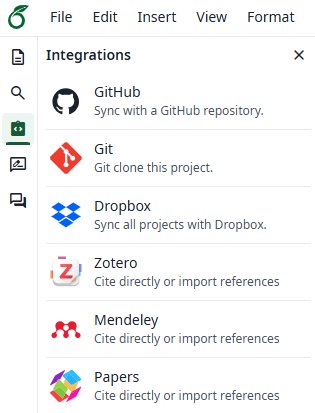
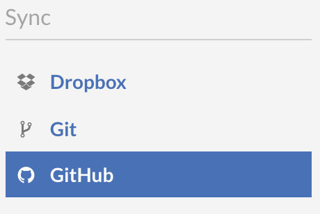
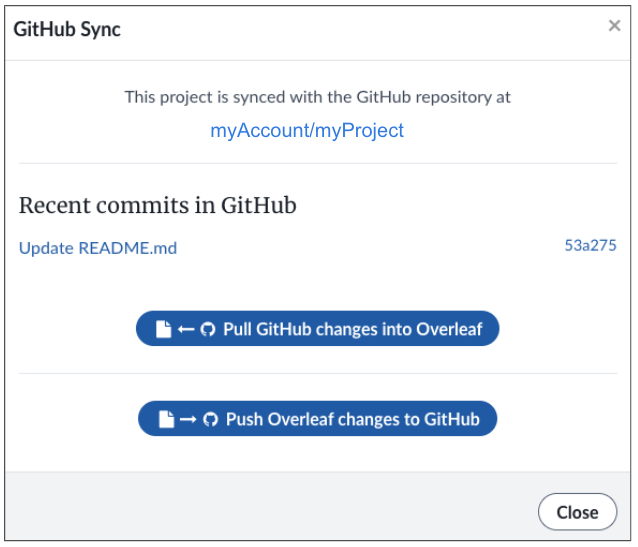
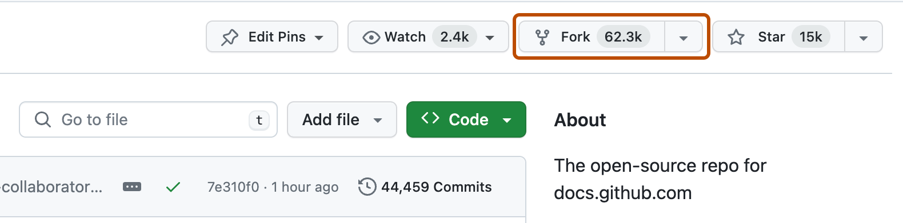
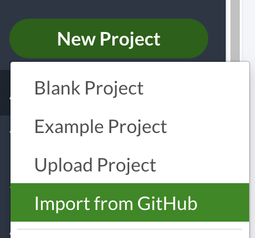

# Parte 2: Configuración Inicial

> **Duración**: 20 minutos  
> **Objetivo**: Tener los 3 proyectos Overleaf y sus forks listos para colaborar

> 💡 **Nota**: La configuración se hace una sola vez. Una vez que los 3 proyectos estén conectados, el flujo diario es mucho más sencillo (lo veremos en la Parte 3).

---

## Resumen de esta parte

| Paso | Quién lo hace | Tiempo |
|------|---------------|--------|
| 2.1 Crear proyecto "Main" en Overleaf | Mauricio (Owner Premium) | 3 min |
| 2.2 Conectar Overleaf "Main" a GitHub | Mauricio (Owner) | 3 min |
| 2.3 Crear forks en GitHub | José Miguel y Rodrigo | 2 min |
| 2.4 Dar acceso a Mauricio en los forks | José Miguel y Rodrigo | 2 min |
| 2.5 Crear proyectos Overleaf desde los forks | Mauricio (Owner) | 3 min |
| 2.6 Compartir proyectos en Overleaf | Mauricio (Owner) | 2 min |
| 2.7 Compartir acceso en GitHub (repo principal) | Mauricio (Owner) | 2 min |
| 2.8 Verificar que todo funciona | Todos | 3 min |

---

## 2.1 Crear proyecto "Main" en Overleaf (Mauricio)

> **Solo Mauricio** realiza este paso. Los demás observan.

### Opción A: Crear proyecto nuevo desde plantilla

1. Ir a [overleaf.com](https://www.overleaf.com) e iniciar sesión
2. Click en **"New Project"** (botón verde)
3. Seleccionar **"Blank Project"** o una plantilla de journal
4. Nombrar el proyecto: `Articulo-Main`

### Opción B: Usar proyecto existente

Si Mauricio ya tiene un proyecto en Overleaf que quiere usar:
1. Abrir el proyecto existente
2. Continuar con el paso 2.2

---

## 2.2 Conectar Overleaf "Main" a GitHub (Mauricio)

> **Requisito**: Cuenta Overleaf Premium y GitHub vinculado (paso de instalación previa)
>
> 💡 **Compatibilidad de interfaz**: Overleaf tiene "diseño nuevo" (Integrations en barra lateral) y "diseño anterior" (GitHub dentro de Menu). Ambas rutas llevan a la misma sincronización.


*Captura de referencia: ruta en diseño anterior de Overleaf.*

### Pasos:

1. Dentro del proyecto en Overleaf, click en **"Menu"** (esquina superior izquierda)

2. En la sección "Sync", buscar **"GitHub"**

3. Click en **"Create a GitHub Repository"**
   - Si es la primera vez, Overleaf pedirá autorización para conectar con GitHub
   - Autorizar la conexión


*Captura de referencia: punto de entrada a GitHub en Overleaf.*

4. Configurar el repositorio:
   | Campo | Valor sugerido |
   |-------|----------------|
   | **Repository name** | `articulo-taller-colaboracion` |
   | **Visibility** | Public (recomendado para el taller) |

   > 💡 **¿Public o Private?** Para el taller, Public es más sencillo porque permite que José Miguel y Rodrigo hagan fork sin pasos extra. Si eligen Private, Mauricio debe agregar a José Miguel y Rodrigo como colaboradores en GitHub **antes** de que ellos puedan hacer fork (ver paso 2.7).

5. Click en **"Create"**

6. **¡Listo!** El proyecto "Main" ahora está sincronizado con GitHub

### Verificar la conexión

- En el menú de Overleaf, ahora verán opciones:
  - **"Push Overleaf changes to GitHub"** — Subir cambios de Overleaf a GitHub
  - **"Pull GitHub changes into Overleaf"** — Traer cambios de GitHub a Overleaf


*Captura de referencia: modal de sincronización Push/Pull en Overleaf.*

> 📖 Fuente oficial: [Overleaf GitHub Synchronization](https://docs.overleaf.com/integrations-and-add-ons/git-integration-and-github-synchronization/github)

---

## 2.3 Crear forks en GitHub (José Miguel y Rodrigo)

> **José Miguel y Rodrigo** realizan este paso cada uno.

Un **fork** es una copia del repositorio principal en su propia cuenta de GitHub. Es su espacio personal para trabajar.

### Pasos:

1. Ir al repositorio principal en GitHub: `github.com/mauricio-username/articulo-taller-colaboracion`
   - Mauricio les compartirá el enlace
2. Click en el botón **"Fork"** (esquina superior derecha)


*Captura de referencia: inicio de creación de fork en GitHub.*
3. En la pantalla de creación del fork:
   - **Owner**: Su cuenta personal de GitHub
   - **Repository name**: Dejar el mismo nombre (`articulo-taller-colaboracion`)
   - ✅ Asegurarse de que "Copy the `main` branch only" esté marcado
4. Click en **"Create fork"**

### Resultado

Ahora cada uno tiene su propia copia del repositorio:
- José Miguel: `github.com/josemiguel-username/articulo-taller-colaboracion`
- Rodrigo: `github.com/rodrigo-username/articulo-taller-colaboracion`

> 💡 **El fork es una copia independiente**: Pueden modificarlo libremente sin afectar el repositorio principal. Los cambios solo llegan al principal cuando crean un Pull Request y es aprobado.

---

## 2.4 Dar acceso a Mauricio en los forks (José Miguel y Rodrigo)

> **¿Por qué?** Para que Mauricio pueda importar sus forks a Overleaf (especialmente si el repositorio es privado).

### Pasos (cada uno en su fork):

1. Ir a su fork en GitHub
2. Click en **"Settings"** → **"Collaborators"**
3. Click en **"Add people"**
4. Buscar el username de Mauricio
5. Enviar invitación


*Captura de referencia: acceso a configuración/collaborators del repositorio.*

> Mauricio debe aceptar las invitaciones desde sus notificaciones de GitHub.

---

## 2.5 Crear proyectos Overleaf desde los forks (Mauricio)

> **Solo Mauricio** realiza este paso. Es el paso clave que habilita la sincronización para todos.

### Para el workspace de José Miguel:

1. En Overleaf, click en **"New Project"** → **"Import from GitHub"**
2. En la lista de repositorios, buscar `josemiguel-username/articulo-taller-colaboracion` (el fork de JM)
3. Click en **"Import"**
4. Overleaf creará un nuevo proyecto con los contenidos del fork de JM
5. Renombrar el proyecto a: `Articulo-JM-Workspace`


*Captura de referencia: importación de repositorio GitHub hacia Overleaf.*

### Para el workspace de Rodrigo:

1. Repetir el mismo proceso con el fork de Rodrigo
2. Buscar `rodrigo-username/articulo-taller-colaboracion`
3. Renombrar a: `Articulo-Rodrigo-Workspace`

### Resultado

Mauricio ahora tiene **3 proyectos** en Overleaf:

| Proyecto Overleaf | Conectado a GitHub | Propósito |
|-------------------|-------------------|-----------|
| `Articulo-Main` | `mauricio/articulo-taller-colaboracion` | Versión oficial del artículo |
| `Articulo-JM-Workspace` | `josemiguel/articulo-taller-colaboracion` (fork) | Espacio de trabajo de José Miguel |
| `Articulo-Rodrigo-Workspace` | `rodrigo/articulo-taller-colaboracion` (fork) | Espacio de trabajo de Rodrigo |

> ⚠️ **Importante**: Cada proyecto Overleaf está vinculado permanentemente a un repositorio GitHub específico. No se puede cambiar después. Por eso es importante hacer bien este paso.

---

## 2.6 Compartir proyectos en Overleaf (Mauricio)

### Compartir cada workspace con su dueño:

**Proyecto "JM Workspace":**
1. Abrir el proyecto `Articulo-JM-Workspace`
2. Click en **"Share"** (botón arriba a la derecha)
3. Ingresar el correo de José Miguel
4. Seleccionar permisos: **"Can Edit"**
5. Click en **"Share"**

**Proyecto "Rodrigo Workspace":**
1. Abrir el proyecto `Articulo-Rodrigo-Workspace`
2. Repetir el proceso con el correo de Rodrigo

**Proyecto "Main" (opcional - solo lectura):**
1. Si quieren que todos puedan ver (pero no editar) el proyecto Main:
2. Compartir con **"Can View"** para José Miguel y Rodrigo

> 💡 **¿Por qué "Can Edit" en los workspaces?** Para que cada persona pueda escribir en su proyecto de Overleaf y usar la función de "Push to GitHub" / "Pull from GitHub". La función de sincronización con GitHub funciona porque Mauricio (Premium) es el owner del proyecto.

---

## 2.7 Compartir acceso en GitHub — repo principal (Mauricio)

Para que José Miguel y Rodrigo puedan ser asignados como revisores, gestionar Issues y tener acceso completo al repositorio:

1. Ir al repositorio **principal** en GitHub: `mauricio/articulo-taller-colaboracion`
2. Click en **"Settings"** → **"Collaborators"**
3. Click en **"Add people"**
4. Agregar a José Miguel y Rodrigo por username o correo
5. Enviar invitaciones

> José Miguel y Rodrigo deben aceptar las invitaciones.

---

## 2.8 Verificar que todo funciona (Todos)

### José Miguel verifica:

1. ✅ Puede abrir su proyecto `Articulo-JM-Workspace` en Overleaf
2. ✅ Puede editar archivos en el proyecto
3. ✅ En Menu → GitHub, ve las opciones de Push/Pull
4. ✅ En GitHub, puede ver su fork: `josemiguel/articulo-taller-colaboracion`

### Rodrigo verifica:

1. ✅ Puede abrir su proyecto `Articulo-Rodrigo-Workspace` en Overleaf
2. ✅ Puede editar archivos en el proyecto
3. ✅ En Menu → GitHub, ve las opciones de Push/Pull
4. ✅ En GitHub, puede ver su fork: `rodrigo/articulo-taller-colaboracion`

### Mauricio verifica:

1. ✅ Puede abrir los 3 proyectos en Overleaf
2. ✅ El proyecto "Main" sincroniza con `mauricio/articulo-taller-colaboracion`
3. ✅ En GitHub, ve los forks de JM y Rodrigo

---

## Diagrama Resumen de la Arquitectura

```
┌─────────────────────────────────────────────────────────────────┐
│                    ARQUITECTURA COMPLETA                        │
└─────────────────────────────────────────────────────────────────┘

 OVERLEAF (Navegador)                  GITHUB (Navegador)
 ════════════════════                  ═══════════════════

 ┌────────────────────┐           ┌────────────────────────┐
 │ Articulo-Main      │  ← sync → │ mauricio/articulo      │
 │ (Owner: Mauricio)  │           │ (repo principal)       │
 │ Solo Pull from GH  │           │                        │
 └────────────────────┘           └───────────┬────────────┘
                                              │
                                    ┌─────────┼─────────┐
                                    │ PRs     │     PRs │
                                    │         │         │
 ┌────────────────────┐    ┌───────┴──┐   ┌──┴───────┐
 │ Articulo-JM        │←→ │ josem/   │   │ rodrigo/ │ ←→┌────────────────────┐
 │ Workspace          │    │ articulo │   │ articulo │    │ Articulo-Rodrigo   │
 │ (Compartido con JM)│    │ (fork)   │   │ (fork)   │    │ Workspace          │
 └────────────────────┘    └──────────┘   └──────────┘    └────────────────────┘

 Leyenda:
 ←sync→  = Push to GitHub / Pull from GitHub (en Overleaf)
 PRs     = Pull Requests (de fork a repo principal)
```

---

## Resumen de acciones de configuración

| Acción | Quién | Dónde |
|--------|-------|-------|
| Crear proyecto Main y conectar a GitHub | Mauricio | Overleaf |
| Crear fork del repo principal | JM y Rodrigo | GitHub |
| Dar acceso a Mauricio en sus forks | JM y Rodrigo | GitHub |
| Importar forks como proyectos Overleaf | Mauricio | Overleaf |
| Compartir proyectos Overleaf | Mauricio | Overleaf |
| Agregar colaboradores al repo principal | Mauricio | GitHub |

---

## Checkpoint ✅

Antes de continuar a la Parte 3, verifiquen que:

- [ ] Existen 3 proyectos en Overleaf (Main, JM Workspace, Rodrigo Workspace)
- [ ] Cada proyecto está conectado a su repositorio GitHub correspondiente
- [ ] JM puede editar y sincronizar su proyecto Overleaf
- [ ] Rodrigo puede editar y sincronizar su proyecto Overleaf
- [ ] Todos pueden ver el repo principal en GitHub

Si algo falla, pidan ayuda antes de continuar.

---

**Anterior**: [← Parte 1 - Conceptos](../01-conceptos/README.md)

**Siguiente**: [Parte 3 - Flujo Básico →](../03-flujo-basico/README.md)
